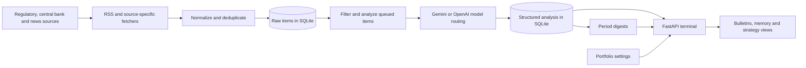

# Macro Radar · Yatırım Radarı

A local research terminal that collects Turkish and global macroeconomic releases, organizes policy developments, and summarizes their possible portfolio implications.

The terminal brings regulatory bulletins, analysis, source coverage, period digests, and portfolio settings into a single browser interface. It retains raw items and structured analysis so users can trace a summary back to its source.

## Architecture and pipeline



- **Ingestion** uses the [source registry](radar_macro/config/sources.py) to select feeds. The pipeline supports filtering by category and jurisdiction and tracks duplicate records.
- **Analysis** extracts structured policy and market-impact signals and maps relevant sectors to BIST tickers. Model selection follows the configured routing strategy.
- **Research terminal** reads stored bulletins, digests, portfolio settings, and strategy memos. The API can trigger ingestion and digest generation from the interface.

## Quick start

Use Python 3.10+ and a Gemini or OpenAI key for model-backed analysis. Run from the repository root so the environment file and default SQLite path resolve consistently.

```powershell
python -m venv .venv
.\.venv\Scripts\Activate.ps1
python -m pip install -r requirements.txt -r radar_core/requirements.txt
Copy-Item .env.example .env
```

Fill in the key and model settings for the provider you plan to use. Start the terminal and open `http://127.0.0.1:8501/`.

```powershell
python run.py --dashboard
```

| Command | Behavior |
| --- | --- |
| `python run.py --help` | Show supported flags without launching a cycle |
| `python run.py --init-db` | Initialize the macro database and exit |
| `python run.py --run-once` | Fetch and analyze one batch across configured sources |
| `python run.py --scheduled --interval 3600` | Repeat the cycle once per hour |
| `python run.py --dashboard --port 8503 --no-browser` | Bind the local terminal to a custom port |

Set `DATABASE_URL` to override the default `sqlite:///./macro_radar.db`. The [environment template](.env.example) lists model and routing settings. Live source coverage depends on feed availability and upstream formats. Model-generated summaries are research inputs and may need to be checked against the underlying release.

## Code map

| Component | Responsibility |
| --- | --- |
| [CLI runner](radar_macro/run.py) | Dashboard, one-off ingestion and scheduling |
| [Macro pipeline](radar_macro/pipeline.py) and [base pipeline](radar_core/pipelines/base_pipeline.py) | Source selection, queue processing and structured analysis |
| [LLM engine](radar_core/core/llm_engine.py) and [data models](radar_core/core/models.py) | Provider calls and persistence contracts |
| [Memory engine](radar_macro/memory_engine.py) and [portfolio module](radar_macro/portfolio.py) | Period summaries and portfolio state |
| [FastAPI server](radar_macro/server.py) and [terminal UI](radar_macro/web/) | Browser interface and operations |
